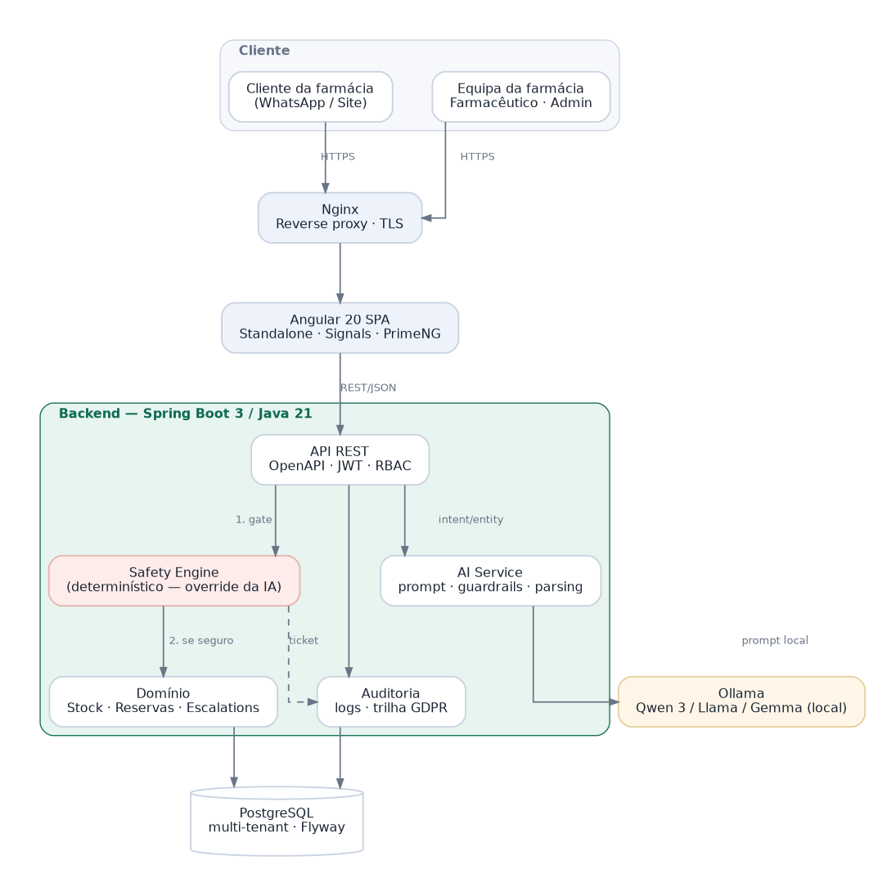
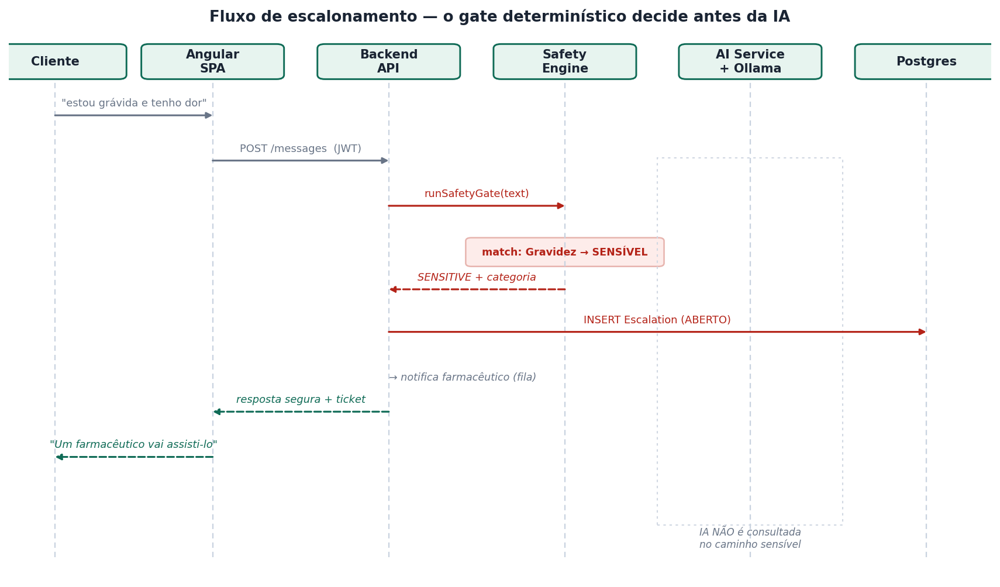
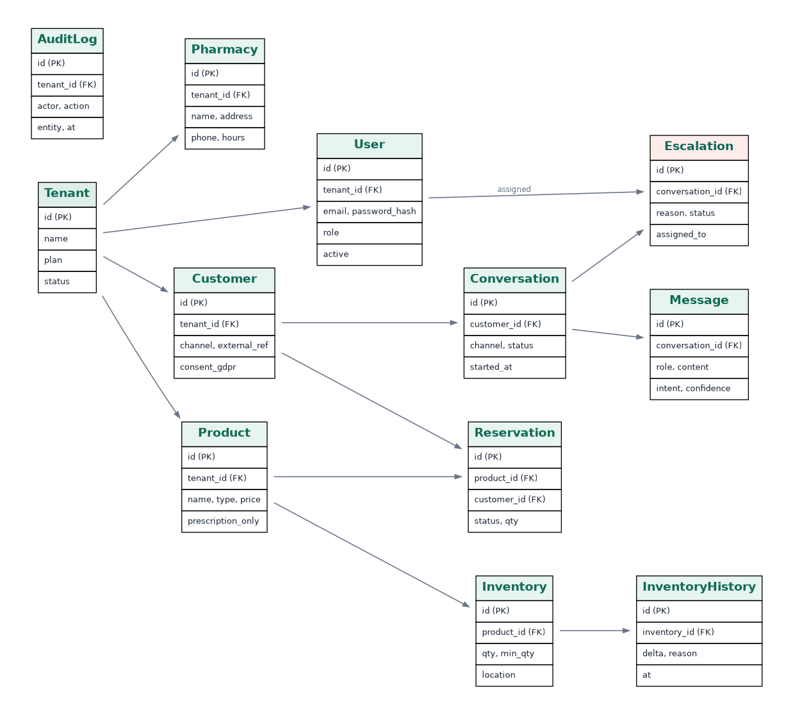

# Documentation

## Contents

| Document | Purpose |
|---|---|
| [`especificacao-funcional-e-tecnica.docx`](especificacao-funcional-e-tecnica.docx) | Full specification: functional requirements (RF-xxx), non-functional requirements, architecture, data model, deployment, risks |
| [`decisoes-arquiteturais.md`](decisoes-arquiteturais.md) | Architecture decision records — what was decided and what was traded away |

## Diagrams

| Diagram | Shows |
|---|---|
|  | Container view — backend mediates all access; the AI is never exposed |
|  | The deterministic gate deciding before the AI is consulted |
|  | Multi-tenant entity-relationship model |

## Mockups

Interface proposals for the pharmacy-facing console: `mockup-atendimento.png`,
`mockup-dashboard.png`, `mockup-inventario.png`.

## Prototypes

Working React prototypes live in [`../prototipos/`](../prototipos):

- **`canal-cliente.jsx`** — customer-facing channel with the safety gate, plus the
  commercial landing page and lead capture used for market validation
- **`consola-interna.jsx`** — internal pharmacy console: escalation queue with SLA,
  reservation lifecycle, inventory, and audit trail

These validate behaviour and flow. They are not the production implementation — the
real system is Angular + Spring Boot per the specification.
